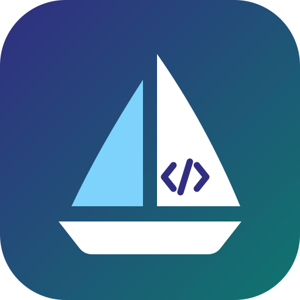

# CodeSail

[](https://github.com/LucasN177/CodeSail/actions/workflows/ci.yml)
[](https://github.com/LucasN177/CodeSail/actions/workflows/deploy.yml)

**CodeSail** is a lightweight, fully client-side code editor built for iPads and other tablets. It runs on **Blazor WebAssembly (.NET 10)** as an installable **Progressive Web App (PWA)**, so everything happens inside the browser. There is no backend.

It connects straight to your **GitHub** repositories through the GitHub REST API. You can browse and edit code on the go, even offline.

**Live app:** https://lucasn177.github.io/CodeSail/

---

## ✨ Features

| | Status |
|---|---|
| **GitHub sign-in** with a fine-grained Personal Access Token, optional "stay signed in" | ✅ |
| **Repository picker** with search | ✅ |
| **File explorer**: full repo tree in one API call, branch switcher, quick file search | ✅ |
| **Monaco editor** (the VS Code engine): syntax highlighting for many languages, multi-cursor, tabs with separate undo history | ✅ |
| **Offline-first**: files, trees and branch lists are mirrored to IndexedDB; edits are saved locally as you type and survive restarts | ✅ |
| **Offline indicator** and API rate-limit display | ✅ |
| **Create, rename, move and delete files** | ✅ |
| **Changes view** with side-by-side diff (Monaco diff editor) | ✅ |
| **Commit & push** several files as one commit, with conflict detection | ✅ |
| **Branches tab**: switch, create, compare with the default branch, rename, delete; shows local changes per branch | ✅ |
| **Pull requests tab**: list, create (incl. drafts), view description and diffs, merge (merge/squash/rebase), close and reopen | ✅ |
| **Live preview** for Markdown and static HTML (side by side or full, sandboxed) | ✅ |
| **Run JavaScript and TypeScript** with an output panel (Cmd+Enter), isolated in a sandboxed Web Worker | ✅ |
| Compile and run C# in the browser (Roslyn) | 🧪 Phase 4B (planned) |

### Workflow

1. Open a repository, pick a branch and tap a file.
2. Edit. Changes are written to the device's IndexedDB about half a second after you stop typing. **Cmd + S** saves immediately.
   Edited files show a **●** in their tab and in the explorer, and reopen automatically after the app was closed.
3. New files: **Files → New file** (use `/` for folders). Rename, move or delete via the **⋮** menu of the open file.
4. For Markdown and HTML files, tap the 👁 icon for a live preview. In landscape it opens next to the code (⛶ shows only the preview); in portrait it toggles between code and preview. Images, stylesheets and scripts from the repository are embedded, including your uncommitted edits.
5. For `.js` and `.ts` files, tap ▶ or press **Cmd + Enter** to run the file. Output from `console.log` appears in a panel at the bottom; tap an error to jump to its line. TypeScript type errors are shown as warnings, syntax errors stop the run. Long-running code can be stopped at any time without freezing the app.
6. The sidebar has four tabs (icons): **Files**, **Changes**, **Branches** and **Pull requests**. In **Branches** you switch, create, compare, rename and delete branches; a badge shows how many files have local changes on each branch. In **Pull requests** you create pull requests and open one to read its description, review the changed files and merge or close it.
7. Switch to the **Changes** tab in the sidebar. It lists every changed (**M**), added (**A**) and deleted (**D**) file. Tap one to see a diff, or use ↶ to discard it.
8. Enter a commit message and tap **Commit & push**. All changes become a single commit.
   Tick **Commit to a new branch** to create a branch instead, and optionally open a pull request against the current branch.

**Conflicts:** Before pushing, CodeSail checks whether any of your files changed on GitHub since you opened them. Changes to *other* files are fine; your commit simply goes on top. If the same file changed, you choose: commit your version anyway (it replaces the GitHub version) or cancel, discard your change and redo it on the new version. Nothing is merged automatically.

**Offline:** CodeSail also starts without a connection and shows the repositories, branches and files you opened before. You can keep editing, creating and deleting files. Committing is disabled until you're back online; nothing is pushed in the background without you.

**Staying up to date:** The ⟳ button next to the branch picker (and on the repository list) reloads from GitHub. Open tabs stay open and local changes are kept. When a new version of CodeSail itself is available, an **Update** button appears in the top bar.

**Expired token:** If GitHub rejects your token while you work, CodeSail takes you to the sign-in page and returns you to where you were afterwards. Local changes stay on the device.

**Empty repositories:** Open one and tap **Create README.md** to make the first commit.

> Signing out deletes the token and all offline copies. CodeSail warns you first if there are uncommitted changes.

---

## 🛠️ Tech Stack

All dependencies are free and open source.

- **Framework:** Blazor WebAssembly (.NET 10), PWA template
- **UI components:** [MudBlazor](https://mudblazor.com/) (MIT)
- **Editor:** Monaco Editor via [BlazorMonaco](https://github.com/serdarciplak/BlazorMonaco) (MIT)
- **Markdown:** [Markdig](https://github.com/xoofx/markdig) (BSD-2-Clause)
- **GitHub client:** [Octokit.NET](https://github.com/octokit/octokit.net) (MIT)
- **Local storage:** IndexedDB through a small JS module (`wwwroot/js/codesail.js`), with no extra library
- **Tests:** xUnit + [bUnit](https://bunit.dev/)
- **CI/CD & hosting:** GitHub Actions + GitHub Pages

---

## 🚀 Getting Started (Local Development)

### Prerequisites
- [.NET SDK 10](https://dotnet.microsoft.com/download). The version is pinned in `global.json`.
- A GitHub **fine-grained Personal Access Token** ([create one](https://github.com/settings/personal-access-tokens/new)) with:
  - **Repository access:** the repositories you want to edit
  - **Permissions:**
    - *Contents: Read and write*: read files, commit, create branches
    - *Pull requests: Read and write*: only needed for the pull requests tab (list, create, merge, close)
    - *Metadata: Read* is added automatically

### Run
```bash
git clone https://github.com/LucasN177/CodeSail.git
cd CodeSail
dotnet watch --project src/CodeSail
```
Open http://localhost:5050 and sign in with your token. In the browser dev tools, switch on the **Device Toolbar** and choose an iPad to check the tablet layout.

### Test
```bash
dotnet test
```

### Project structure
```
src/CodeSail/
  Components/        FileExplorer, SourceEditor + DiffView (Monaco), PreviewPane, RunPanel, ChangesPanel, BranchesPanel, PullRequestsPanel + PullRequestView, dialogs
  Layout/            App shell: app bar, auth guard, offline/rate-limit indicators
  Pages/             Home (sign-in), Repos, Workspace
  Services/          AuthState, WorkspaceService (loading, file operations), CommitService, PullRequestService, BrowserEnvironment
  Services/GitHub/   GitHub API (Octokit + direct Git Data calls), tree builder, error messages
  Services/Storage/  Token store, IndexedDB file cache
  Services/Preview/  Markdown/HTML preview (rendering, embedding repo files)
  Services/Run/      Run session state for the JavaScript/TypeScript runner
  wwwroot/js/        codesail.js (IndexedDB, preview, connectivity), runner.js (JS/TS runner), pwa.js (updates)
tests/CodeSail.Tests/
tools/render-icons.cs  Regenerates the PNG icons from the SVG logo (dotnet run tools/render-icons.cs)
docs/IMPLEMENTATION_PLAN.md
```

---

## 🔐 Security & Privacy

- Your token never leaves the device except in requests to `api.github.com`.
- By default it is kept in `sessionStorage` and removed when the tab closes. With "stay signed in" it goes to `localStorage`.
- There is no server and no telemetry.
- The preview runs repository HTML and scripts in a sandboxed iframe without same-origin access, so they cannot read your token or the offline cache.
- Code you run is executed in a Web Worker inside such a sandbox: it has no access to the token, `localStorage` or the offline cache, and stopping it terminates the worker.

The repository itself needs **no secrets**. See [SECRETS.md](SECRETS.md).

---

## 🌐 Deployment

Every push to `main` builds the app and publishes it to GitHub Pages ([deploy.yml](.github/workflows/deploy.yml)). One-time setup: **Settings → Pages → Source: GitHub Actions**.

## 📱 Using as a PWA

Open the live URL in **Safari on your iPad**, tap **Share → Add to Home Screen**. CodeSail then launches full-screen without browser bars. After the first launch the app itself also loads offline.

---

## 🗺️ Roadmap

- [x] **Phase 0:** Project setup, CI, GitHub Pages deployment
- [x] **Phase 1:** GitHub authentication & repository tree explorer
- [x] **Phase 2:** Monaco editor integration with offline caching (IndexedDB)
- [x] **Phase 3:** Commit & branch management workflow
- [x] **Phase 3b:** Live preview for Markdown and HTML
- [x] **Phase 3c:** Branch management and pull requests tabs
- [x] **Phase 4A:** Run JavaScript and TypeScript in the browser
- [ ] **Phase 4B:** Compile and run C# with Roslyn in a Web Worker *(next: feasibility spike, see the plan)*

Details: [docs/IMPLEMENTATION_PLAN.md](docs/IMPLEMENTATION_PLAN.md)

---

## 📄 License

Distributed under the MIT License. See [LICENSE](LICENSE).
